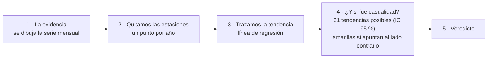
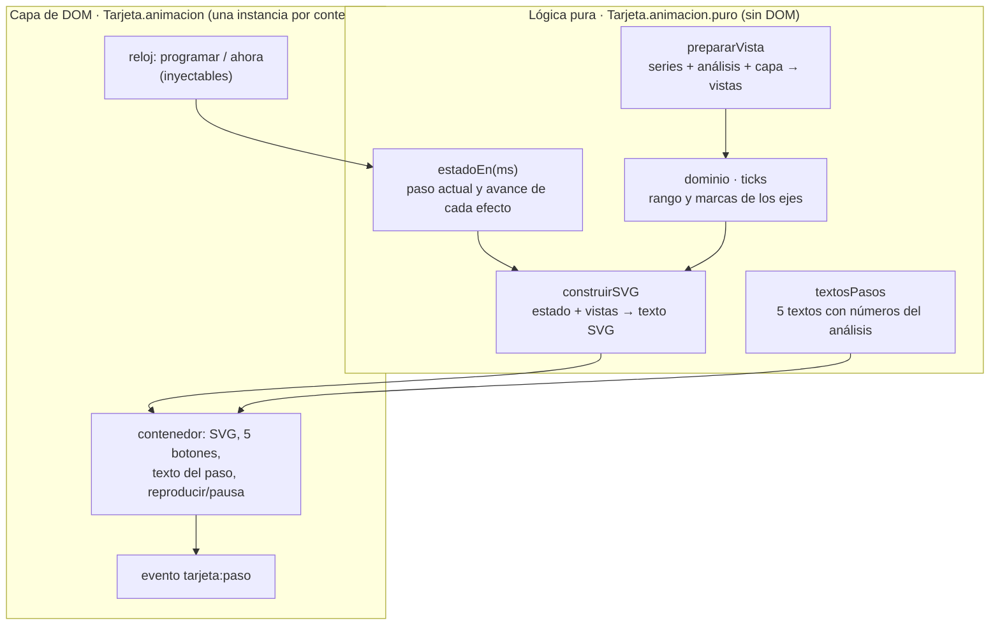

# Tarjeta y prueba detallada (Tarea 3)

Dos componentes para mostrar la tendencia de un lugar:

1. **La tarjeta sencilla**, para todo público: antes → hoy, "¿es seguro?" explicado con monedas, "¿qué significa?" y "desde que naciste".
2. **La prueba detallada**: una animación de 5 pasos que muestra cómo se descubre la tendencia.

No calculan la tendencia de la tarjeta ni descargan nada. Reciben los datos ya calculados con `web/src/stats.js` y los muestran. Quien los pone en el globo es la Tarea 2.

Página de demostración: [`web/demo/tarjeta.html`](../web/demo/tarjeta.html).

## Qué muestra cada parte

### La tarjeta (`Tarjeta.html`)

Ejemplo real, con el suelo del norte de México:

| Parte | Ejemplo | De dónde sale |
|---|---|---|
| Encabezado | **Norte de México** · Agua en el suelo, con un icono | `resumen.lugar` y la capa |
| Antes → hoy | Antes (1982–91) **27.8 %** → Hoy (2016–25) **25.5 %** | `antes`, `hoy` y sus periodos, convertidos de unidad |
| Veredicto corto | ▼ El suelo se está secando (2.3 puntos menos) | dirección de `pendiente_decada`, `veredicto` y `hoy − antes` |
| ¿Es seguro? | 5 de 10 monedas encendidas: "Como sacar 5 caras seguidas: pasa 1 vez de cada 32. Probablemente es real, aunque con menos margen." | `caras` y `veredicto` |
| ¿Qué significa? | "Plantas y cultivos tienen menos agua: se necesita más riego que antes." | textos de la capa |
| Desde que naciste | "Desde que naciste (2005): 1.2 puntos menos." | `pendiente_decada` y el año de nacimiento |
| Aviso | "⚠ Datos de prueba, no reales." | solo si `ilustrativo` es `true` |

Si el cambio no es seguro, el veredicto dice "≈ Sin cambio claro (+11 %, puede ser suerte)". Si faltan `antes`, `hoy` o `p` (por ejemplo, suelo en el mar), muestra "Sin datos para este lugar" con una frase amable.

La información nunca depende solo del color. El veredicto lleva flecha y texto. Las monedas encendidas van rellenas y las apagadas solo con borde, y tienen un texto equivalente para lectores de pantalla.

### La comparación (`Tarjeta.htmlComparacion`)

Pone las tarjetas lado a lado, con una frase arriba:

| Caso | Frase |
|---|---|
| Las dos seguras y con direcciones opuestas | Depende del lugar: en uno sube y en otro baja. |
| Las dos seguras y suben | En los dos lugares sube. |
| Las dos seguras y bajan | En los dos lugares baja. |
| Solo una segura | Solo en uno de los dos lugares el cambio es seguro. |
| Ninguna segura | En ninguno de los dos lugares hay un cambio claro. |

Un indicio o un lugar sin datos no cuentan como seguros. Con 3 o más lugares, las frases cambian ("En todos los lugares sube", "Solo en 2 de los 3 lugares…").

### La animación (`Tarjeta.animacion`)

Una gráfica con 5 botones de paso, el texto del paso y un botón para reproducir o pausar. Al crearse muestra la gráfica completa. "▶ Ver cómo lo descubrió" la anima desde el principio.



Con dos series (comparación), cada valor se muestra como % arriba o abajo del promedio de su propia serie, para poner los dos lugares en la misma escala.

## Cómo usarlos desde la Tarea 2

### 1. Cargar los archivos

```html
<link rel="stylesheet" href="src/tarjeta.css">
<!-- en este orden, después del script principal de la página -->
<script src="src/stats.js"></script>
<script src="src/tarjeta_capas.js"></script>
<script src="src/tarjeta.js"></script>
<script src="src/animacion.js"></script>
```

Los archivos solo crean un global: `Tarjeta`. Por dentro todo va en funciones autoejecutables, así que no chocan con `$`, `esc`, `CFG`, `LUGARES` y demás de `index.html`. Las clases CSS llevan el prefijo `tj-`. Los colores salen de las variables de la página (`--warm`, `--cool`, `--muted`…) y tienen valor de respaldo.

> `index.html` ya trae su propia copia en línea de `stats.js`. Si se sigue usando esa copia en lugar de `src/stats.js`, no hay que cargarla otra vez: `const Stats` declarado dos veces rompe la página con `SyntaxError`.

### 2. Armar el `resumen` con `stats.js`

```js
// valores: serie mensual de la celda (data/series/<capa>/<ti>_<tj>.json), en la unidad original de la capa
function armarResumen(valores, inicio, lugar, capa, ilustrativo) {
  const r = Stats.analizar(valores, inicio);
  const v = Stats.veredicto(r);
  const anios = r.anual.filter((a) => a.completo);
  const k = Math.min(10, Math.floor(anios.length / 2));
  const A = anios.slice(0, k), B = anios.slice(-k);            // primeros y últimos 10 años completos
  const prom = (x) => x.reduce((s, a) => s + a.v, 0) / x.length;
  const p = Math.max(r.pT, r.pMK);
  return {
    resumen: {
      antes: prom(A), hoy: prom(B),
      antes_periodo: [A[0].y, A[A.length - 1].y], hoy_periodo: [B[0].y, B[B.length - 1].y],
      unidad: capa.unidad,                                    // la unidad original: "°C", "mm/día", "m³/m³", "NDVI"
      pendiente_decada: r.porDecada, ic95: r.icDecada, p,
      veredicto: v.clave,                                     // también acepta el objeto v
      caras: Math.max(0, Math.floor(-Math.log2(Math.max(p, 1e-300)))),
      lugar, ilustrativo,
    },
    analisis: r,                                              // la animación lo reutiliza
  };
}
```

### 3. Mostrar la tarjeta y la animación

```js
let animacion = null;

function mostrarLugar({ valores, inicio, lugar, capaId, capa }) {
  const { resumen, analisis } = armarResumen(valores, inicio, lugar, capa, capa.ilustrativo);

  document.querySelector("#tarjeta").innerHTML =
    Tarjeta.html(resumen, { capa: capaId, anioNacimiento: Tarjeta.anioGuardado() ?? undefined });

  if (animacion) animacion.destruir();                       // siempre, antes de crear otra
  animacion = Tarjeta.animacion(document.querySelector("#prueba"), { valores, inicio },
    { capa: capaId, unidad: capa.unidad, lugar, analisis });
}

// al volver al globo o cambiar de lugar
function cerrarLugar() {
  if (animacion) { animacion.destruir(); animacion = null; }
}

// el Detective (Tarea 4) puede seguir los pasos de la animación
document.querySelector("#prueba").addEventListener("tarjeta:paso", (e) => console.log("terminó el paso", e.detail.paso));
```

Para comparar dos lugares:

```js
document.querySelector("#tarjeta").innerHTML = Tarjeta.htmlComparacion([resumenSahel, resumenNorte], { capa: "suelo" });
animacion = Tarjeta.animacion(contenedor, [serieSahel, serieNorte],
  { capa: "suelo", lugar: ["el Sahel", "el norte de México"], analisis: [analisisSahel, analisisNorte] });
```

## Referencia

### Campos del `resumen`

| Campo | Tipo | Ejemplo | ¿Obligatorio? |
|---|---|---|---|
| `antes` | número, en la unidad original de la capa | `20.1` | sí |
| `hoy` | número, en la unidad original | `21.0` | sí |
| `p` | número | `0.0004` | sí |
| `pendiente_decada` | número, unidad original por década | `0.35` | recomendado (decide la dirección) |
| `veredicto` | `"muy"`, `"si"`, `"indicio"`, `"no"` o `{ clave, texto }` | `"muy"` | recomendado |
| `caras` | entero ≥ 0 | `11` | si falta, se calcula con `p` |
| `antes_periodo` | `[año_inicio, año_fin]` | `[2000, 2009]` | no |
| `hoy_periodo` | `[año_inicio, año_fin]` | `[2016, 2025]` | no |
| `unidad` | texto, la unidad original | `"°C"` | para capas sin configuración |
| `ic95` | `[número, número]` | `[0.21, 0.49]` | no (no se muestra en la tarjeta) |
| `lugar` | texto (se escapa) | `"Morelos, México"` | no |
| `ilustrativo` | booleano | `false` | no |

Si falta un campo opcional, la tarjeta se muestra sin esa parte, sin `undefined` ni `NaN`. Si faltan `antes`, `hoy` o `p`, sale la tarjeta "Sin datos para este lugar".

### Opciones de `Tarjeta.html(resumen, opciones)`

| Opción | Qué hace |
|---|---|
| `capa` | `"temp"`, `"lluvia"`, `"suelo"`, `"verdor"` u otra. Si no está registrada, se usa la configuración genérica. |
| `anioNacimiento` | Año para "Desde que naciste". Sin él, esa parte no se muestra. |
| `textos` | Reemplaza frases, en texto plano que se escapa: `variable`, `veredicto`, `seguro` (el texto de las monedas), `significa`, `desde`, `sinDatos`, `aviso`. Sirve, por ejemplo, para la narración del Detective. |

`Tarjeta.htmlComparacion(resumenes, opciones)` acepta las mismas opciones, compartidas por todas las tarjetas, y además:
- `porTarjeta`: un arreglo con las opciones propias de cada tarjeta;
- `textos.comparacion`: reemplaza la frase de arriba.

**"Desde que naciste"** se calcula con la fórmula `cambio ≈ pendiente_decada / 10 × (año_fin − max(año_nacimiento, año_inicio))`:
- si la persona nació antes del inicio de los datos, dice "Desde 2000 (cuando empiezan estos datos)";
- si nació en el último año o después, no se muestra;
- si el cambio no es seguro, dice "sin cambio claro".

`Tarjeta.anioGuardado()` y `Tarjeta.guardarAnio(anio)` leen y guardan el año en `localStorage` con la clave `"terraAnio"`. Si `localStorage` falla, no pasa nada.

### `Tarjeta.animacion(contenedor, serie, opciones)`

`serie` es `{ valores, inicio }`, o un arreglo de hasta 2 series para comparar.

| Opción | Por defecto | Qué hace |
|---|---|---|
| `capa`, `unidad` | configuración genérica | Unidades de los ejes y textos |
| `lugar` | — | Texto, o un arreglo con un nombre por serie |
| `textos` | textos de cada paso | Arreglo de 5 textos; los vacíos se ignoran |
| `analisis` | lo calcula con `Stats.analizar` | Resultado de `Stats.analizar`, o un arreglo con uno por serie |
| `stats` | el `Stats` global de `stats.js` | Motor estadístico |
| `programar`, `cancelar`, `ahora` | `requestAnimationFrame`, `cancelAnimationFrame`, `performance.now` | Para que las pruebas controlen el tiempo |
| `reducirMovimiento` | lee `prefers-reduced-motion` | Si es `true`, `reproducir()` salta al final |
| `id` | uno único | Prefijo de los ids internos |

Devuelve un controlador:

| Método | Qué hace |
|---|---|
| `reproducir()` | Anima desde donde iba; si ya terminó, empieza desde el paso 1 |
| `pausar()` | Detiene la animación en el instante actual |
| `irAPaso(i)` | Muestra el paso `i` (0 a 4) completo |
| `estado()` | Devuelve `{ paso, corriendo, terminado }` |
| `destruir()` | Cancela la animación, quita los eventos y vacía el contenedor; después, ningún método falla |

Al terminar cada paso, el contenedor emite `tarjeta:paso` con `{ paso }` en `detail`.

### Capas

| Capa | Unidad que llega (pipeline) | Cómo se muestra | Conversión | Cambio |
|---|---|---|---|---|
| `temp` | °C | °C, 1 decimal | ×1 | absoluto: "+0.9°" |
| `lluvia` | mm/día | mm al año, sin decimales | ×365.25 | relativo: "−8 %" (absoluto en mm si `antes` es 0) |
| `suelo` | m³/m³ (0–10 cm) | % de agua en el suelo, 1 decimal | ×100 (0.25 m³/m³ = 25 %) | en puntos: "3 puntos menos" |
| `verdor` | NDVI (0 a 1) | índice de verdor, 2 decimales | ×1 | absoluto: "+0.04" |
| otra | la del `resumen` | la del `resumen`, 1 decimal | ×1 | absoluto, sin tono cálido ni frío |

El suelo se muestra en % y por eso el cambio va en **puntos**: "27 % → 24 % (−11 %)" confunde.

**Signos distintos.** A veces la tendencia (`pendiente_decada`) y `hoy − antes` apuntan a lados distintos, porque un año extremo pesa en un promedio de 10. En ese caso el veredicto muestra la tendencia por década, por ejemplo "▲ Más calor que antes (+0.20° por década)", para no decir "Sube" con un número negativo al lado.

## Cómo agregar una capa nueva

Por ejemplo, la cobertura de nieve, que llega como fracción de 0 a 1:

1. Escribe la configuración con todos los campos (la lista está en `Tarjeta.camposCapa`):

   ```js
   Tarjeta.registrarCapa({
     id: "nieve",
     variable: "Cobertura de nieve",
     icono: "nube",                       // "sol" | "nube" | "brote" | "hoja"
     convertir: (v) => v * 100,           // fracción → %
     unidadCorta: "%",
     unidadLarga: "% del terreno con nieve",
     decimales: 0,
     cambioComo: "puntos",                // "absoluto" | "porcentaje" | "puntos"
     subirEsCalor: false,                 // false: subir = tono frío/agua
     frases: { sube: "Hay más nieve que antes", baja: "Hay menos nieve que antes" },
     significa: {
       sube: "…", baja: "…",
       nada: "Con estos datos todavía no podemos decir que haya cambiado. Hay que seguir midiendo.",
     },
   });
   ```

2. Ponla en `web/src/tarjeta_capas.js`, junto a las otras 4, o en cualquier script que cargue después.
3. Si falta un campo, `registrarCapa` lanza un error que dice cuál, por ejemplo `falta el campo "significa.nada"`.
4. Usa `{ capa: "nieve" }` en `Tarjeta.html` y `Tarjeta.animacion`. No hay que tocar nada más.
5. Agrega un caso en `tests/tarjeta/capas.test.js` con su conversión.

Si nadie registra la capa, igual se ve bien con la configuración genérica: la unidad del `resumen`, sin conversión y con textos neutros.

## Cómo está hecha la animación

La lógica pura no toca el DOM y se prueba en Node. La capa de DOM es delgada: crea los controles y, en cada cuadro, pide a la lógica pura el SVG de ese instante.



Cada instancia guarda su propio estado y su propio id de recorte del SVG, así que puede haber varias animaciones en la misma página. El máximo de series por gráfica es la constante `MAX_SERIES = 2`.

## Textos de "¿Qué significa?" (para la revisión de la Tarea 5)

Están en `web/src/tarjeta_capas.js`, marcados con `// REVISAR(Tarea 5)`. Sirven para cualquier lugar del mundo: se quitaron las menciones a sitios concretos del prototipo, como las sequías del Sahel en los años 80.

| Capa | Frase si sube / si baja | ¿Qué significa? si sube | Si baja | Si no es seguro |
|---|---|---|---|---|
| `temp` | Más calor que antes / Más fresco que antes | Más días de calor, más riesgo de golpes de calor y más agua para regar. | Menos días de calor extremo. Plantas y cultivos pueden cambiar sus temporadas. | Con estos datos todavía no podemos decir que haya cambiado. Hay que seguir midiendo. |
| `lluvia` | Llueve más que antes / Llueve menos que antes | Más agua para cultivos y presas, y más riesgo de inundaciones. | Menos agua para cultivos, pastos y presas. | Por ahora no hay razón para cambiar planes por la lluvia. Hay que seguir midiendo varios años más. |
| `suelo` | El suelo tiene más agua / El suelo se está secando | Más agua disponible para las raíces de plantas y cultivos. | Plantas y cultivos tienen menos agua: se necesita más riego que antes. | Con estos datos todavía no podemos decir que haya cambiado. Hay que seguir midiendo. |
| `verdor` | Más verde que antes / Menos verde que antes | Hay más vegetación o las plantas están más sanas que antes. | Hay menos vegetación o las plantas están más estresadas, por ejemplo por sequía, incendios o cambios en el uso del suelo. | Con estos datos todavía no podemos decir que haya cambiado. Hay que seguir midiendo. |
| genérica | Sube / Baja | El aumento es real. Todavía no tenemos una explicación sencilla para esta variable. | La disminución es real. Todavía no tenemos una explicación sencilla para esta variable. | Con estos datos todavía no podemos decir que haya cambiado. Hay que seguir midiendo. |

También conviene revisar los textos de las monedas (en `tarjeta.js`, función `textoMonedas`) y los de los 5 pasos (en `animacion.js`, función `textosPasos`).

## Pruebas

```bash
node --test tests/tarjeta/*.test.js   # solo las de la tarjeta (178 pruebas)
python -m pytest tests/ -q            # todo: paridad + tarjeta (lo que corre el CI)
```

| Archivo | Qué prueba |
|---|---|
| `tests/tarjeta/capas.test.js` | Las 4 capas, conversiones, configuración genérica, `registrarCapa` y el formato `es-MX` (sin `-0`, `NaN` ni `Infinity`) |
| `tests/tarjeta/tarjeta.test.js` | Las 10 series reales sin textos rotos; seguro, no seguro e indicio; 0 caras y más de 10; sin datos; ilustrativo; escape de texto; año de nacimiento; signos distintos |
| `tests/tarjeta/comparacion.test.js` | Las frases de la comparación y el caso real Sahel vs. norte de México |
| `tests/tarjeta/animacion_puro.test.js` | `estadoEn`, `dominio`, `ticks`, `prepararVista` (312 y 528 meses, huecos, comparación), `construirSVG` y `textosPasos` |
| `tests/tarjeta/animacion_control.test.js` | El controlador, con un contenedor y un reloj falsos: orden de pasos, pausa, `irAPaso`, movimiento reducido, eventos, dos instancias, `destruir` y la carga como scripts del navegador |
| `tests/tarjeta/css.test.js` | Prefijo `tj-` en el CSS y en el HTML, estilo para cada clase y respaldo en cada `var()` |
| `tests/test_tarjeta.py` | Corre las anteriores con Node desde pytest |

`tests/tarjeta/ayudante.js` arma los resúmenes desde `data/muestras/series_reales.json`, igual que lo hará la Tarea 2. Es **solo para pruebas**. Las muestras no vienen todas en la unidad final de cada capa:
- la lluvia de Morelos se pasa de mm/mes a mm/día;
- el suelo (m³/m³ de 10–40 cm) se multiplica por 100. **Ese ×100 es solo una aproximación** para tener valores realistas, no una conversión física.

### Lista de verificación manual

Desde la **raíz del repositorio**:

```bash
python -m http.server 8000
```

Abre `http://localhost:8000/web/demo/tarjeta.html` y revisa:

- [ ] Las 10 series se ven bien, sin textos rotos (`undefined`, `NaN`, `null`).
- [ ] La animación corre, se pausa, salta de paso al tocar un número y se repite con "⟲ Repetir".
- [ ] Las dos animaciones (la serie y la comparación) corren a la vez sin pisarse.
- [ ] Con "reducir movimiento" activado en el sistema, o con la casilla de la demo, "Ver cómo lo descubrió" salta al final.
- [ ] Con el tema oscuro del sistema, todo se lee bien.
- [ ] En celular, la tarjeta y la animación caben, y los botones se pueden tocar.
- [ ] Con el teclado (Tab, Enter, Espacio) se llega a todos los controles y el foco se ve.
- [ ] La animación se ve fluida, sin tirones, en una computadora normal.
- [ ] Al cambiar el año de nacimiento, "Desde que naciste" cambia y se recuerda al recargar.
- [ ] Los casos especiales (sin datos, ilustrativo, verdor, ozono, signos distintos) tienen mensajes claros.

En GitHub Pages la demo queda en `…/demo/tarjeta.html`.

## Limitaciones y pendientes

**Supuestos sobre el `resumen` que la Tarea 2 debe confirmar** (`// PENDIENTE(contrato)` en `web/src/tarjeta.js`):
- Un `veredicto` con una clave desconocida se trata como `"no"` (no seguro).
- Si no llega `pendiente_decada`, la dirección sale de `hoy − antes`.
- Si no llegan las `caras`, se calculan con `p` (⌊−log₂ p⌋).
- Un veredicto seguro con 0 o 1 cara no debería ocurrir. Si llega, la tarjeta deja que mande el veredicto ("Las pruebas dicen que el cambio es real").
- La capa (`opciones.capa`) llega aparte porque la lista de campos acordada del `resumen` no la incluye.

**Otros:**
- La tarjeta no muestra `ic95`. La animación sí muestra la incertidumbre, con las líneas fantasma.
- "Desde que naciste" es una aproximación lineal con `pendiente_decada`, porque el `resumen` no trae la línea de tendencia completa.
- La animación se limita a 2 series por legibilidad (`MAX_SERIES`). `htmlComparacion` acepta más.
- No hay muestra real de `verdor`: se probó con resúmenes hechos a mano.
- Las pruebas automáticas usan un DOM falso. La apariencia, el tema oscuro, el celular y la fluidez se revisan a mano con la lista de arriba.
- La integración en `index.html` la hace la Tarea 2: `index.html` todavía usa su propia tarjeta (`tarjetaReal`, `tarjetaVacia`).
